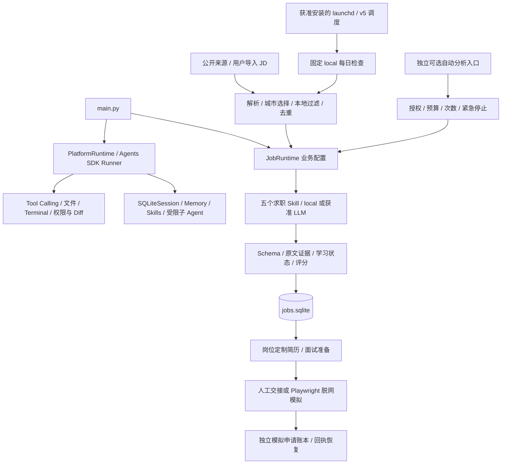

# AI Agent Platform + Job Agent

面向技术实习求职的 AI 辅助开发作品集：用统一 Agent 底座完成岗位发现、JD 理解、简历证据匹配、技能差距分析、岗位管理，以及简历定制和面试准备。

**真实 JD 与本地简历的分析、材料生成、SQLite 保存和去重已验证；两个准备 Skill 已完成使用人工材料的真实 LLM 验收。Playwright 申请链路仅通过脱网模拟验证，尚未实现经过验收的真实全自动投递。** 本项目不声称已获得录用、服务生产用户或独立完成全部代码。

默认 `local`，离线演示无需 API Key；`llm` 需要确认资料外发与费用。自动分析扩展默认预算为零，真实提交接口关闭，克隆仓库不会安装系统任务。最新整理与测试结果见 [稳定版审查](docs/STABLE_RELEASE_REVIEW.md)。

## 解决的问题与功能范围

| 能力 | 已实现的内容 | 验证与使用边界 |
| --- | --- | --- |
| 统一 Platform | Agent Loop、Tool Calling、文件 / Terminal、Session / Memory、Skills、Diff 审批、受限子 Agent、后台任务 | 默认模拟模型，真实工具执行；只操作允许的工作区，不是任意代码沙箱 |
| JD 与简历分析 | 必须项 / 加分项 / 组合要求、学历专业与实习资格、原文证据、技能差距 | local 规则保留未知项；LLM 使用 Schema 和证据校验，仍需人工核对语义 |
| 搜索与排序 | 公开 HTTPS 来源、岗位卡片 / JSON-LD / 部分公开接口、JD 导入、分层匹配度 | 广州 >>> 上海 > 深圳；来源可读取不代表在招或适合申请 |
| SQLite 岗位库 | 稳定编号、JD 版本、投递状态、备注、分析缓存 | JD 更新保留原状态与历史；模拟申请不会写成真实已投递 |
| 每日更新 | 新增 / 实质变化分析、摘要、最近检查、持久计划与跨进程锁、macOS launchd 适配 | 现有每日任务固定 local；安装需本人确认，不承诺关机时运行 |
| 五个业务 Skill | JD 分析、证据匹配、技能差距、完整简历与修改说明、十道面试题及清单 | 不编造能力，不覆盖原简历，真实资料默认本地 |
| 可选自动 LLM | 本地预筛、分析缓存、持久化预算预留 / 结算、次数限制、失败停止 | 完整流程经 mock 回归；真实自动批次及生产部署未验收、未默认启用 |
| Auto Apply 基础架构 | 资格优先决策、材料与目标绑定、申请意图 / 回执、重复保护、未知结果恢复、紧急停止 | 仅人工交接和本地模拟适配器，没有真实企业提交出口 |
| 可选 Playwright | 受限 HTML 快照渲染、文本 / 选择 / 文件填写、模拟收件 | 实际 Chromium 脱网测试通过；Lever 是人工快照原型，非真实线上表单适配完成 |

资格判断优先于匹配分：校招正式岗位不能自动当实习，2027 届 / 本科 / 专业 / 到岗条件不明时标记待确认。Python 基础不算熟练，学习中技能不算掌握，SQLite 项目不证明 SQL 熟练度，职业目标和项目名称不能代替具体实现证据。

## 架构与核心技术栈



- **Python + OpenAI Agents SDK**：复用 Runner、函数工具、SQLiteSession 与 `Agent.as_tool`，不重写通用 Agent 框架。
- **OpenAI 兼容客户端 + Pydantic**：结构化 JSON、模型配置、Token / 费用统计与原文证据约束。
- **SQLite + httpx2 + pypdf**：岗位与运行状态、本地简历解析、受限公开 HTTP 和测试替身。
- **Playwright Python（可选）**：成熟浏览器定位、等待、文件输入与网络拦截；未接入重复浏览器 Agent 框架。

`JobRuntime` 继承统一底座，只配置求职 instructions、tools、memory、skills 和权限。Agent Loop 是“输入 → 工具选择 → 执行 → 回传 → 继续或结束”；默认本地模型使用固定编排，不宣传为完全自主规划。详细边界见 [架构说明](docs/ARCHITECTURE.md)。

## 安装

本机验证环境：Python 3.14；其他 Python / 操作系统组合需要自行验证。进入包含 `main.py` 的项目根目录：

```sh
python3 -m venv .venv
.venv/bin/python -m pip install -r requirements.txt
.venv/bin/python -m pip check
```

核心版本固定在 [requirements.txt](requirements.txt)，不需要 Skill、插件、MCP 或浏览器即可运行基本演示。PDF / DOCX / TXT / MD 简历解析都在本机完成；程序不自动读取 `.env`。

Playwright 单独安装在隔离环境，完整步骤见 [浏览器集成](docs/BROWSER_INTEGRATION.md)。本轮未增加依赖；包及可选组件许可见 [第三方依赖说明](docs/THIRD_PARTY_DEPENDENCIES.md)。项目本身暂未添加 LICENSE，公开可见不等于授予任意复用许可。

## 十分钟离线演示

下面只用人工材料，不调用付费 API，不访问招聘企业。

### 1. 统一底座

```sh
.venv/bin/python -B main.py --self-check
.venv/bin/python -B main.py --state-dir .agent-platform/portfolio-platform
```

自检会先展示故意写错的样例测试失败，再验证获准修复后的通过；最终以“平台本地演示验证：通过”为准。

交互输入 `37 + 58`，再输入 `继续加 2`；应看到真实工具结果 95 和 97。输入 `/help` 查看 Diff 审批、持久记忆、Skill 和子 Agent 演示，`/quit` 退出。完整脚本见 [DEMO.md](DEMO.md)。

### 2. JD → 匹配 → 差距 → 岗位库 → 材料

```sh
.venv/bin/python -B main.py --agent job --mode local \
  --resume job_agent/examples/resume.example.md \
  --jd job_agent/examples/jd.example.md \
  --state-dir .agent-platform/portfolio-job

.venv/bin/python -B main.py --agent job --mode local \
  --resume job_agent/examples/resume.example.md \
  --state-dir .agent-platform/portfolio-job
```

第二条进入交互界面：

```text
/jobs
/job 1
/status 1 shortlisted
/note 1 准备项目答辩
/tailor 1
/interview-prep 1
/jobs shortlisted
/quit
```

重复分析同一 JD 验证复用与稳定编号。`/tailor` 分别保存完整 Markdown 简历与修改说明，`/interview-prep` 保存十道问题、参考答案和准备清单；都在独立状态目录，不覆盖原件。

| Skill | 作用 |
| --- | --- |
| `analyze-jd` | 区分职责、必须项、加分项、学历 / 专业，保留“任一 / 或 / 至少一项”语义 |
| `match-resume` | 原文证据匹配，区分完全、部分、未找到证据与待确认 |
| `skill-gap-analysis` | 已有能力、缺口、补强优先级和验证方法 |
| `resume-tailor` | 依据真实经历针对 JD 调整完整简历，保留修改前后与原因 |
| `interview-prep` | 岗位技术题、真实项目追问、答案、学习建议与一致的准备清单 |

完全 / 部分 / 未匹配按 1 / 0.5 / 0 计分，必须项权重 2、加分项 1，任选组合只算一次。分别报告硬技能完全覆盖率、必须项 / 加分项匹配度与综合匹配度；匹配分不是录用概率。

### 3. 搜索、去重与每日摘要

```sh
.venv/bin/python -B main.py --agent job --search-demo --mode local \
  --state-dir .agent-platform/portfolio-search

.venv/bin/python -B main.py --agent job --check-now --search-demo --mode local \
  --state-dir .agent-platform/portfolio-daily
```

同状态目录重复运行，未变化岗位应显示新分析数为 0。使用相同目录进入交互后，通过 `/last-check`、`/new-jobs` 查看检查与新增记录。

真实求职时，`--resume` 指向自己本机文件；先选择已核验来源再启用 `--allow-network`，不要把 `--search-demo` 当作实时搜索。来源失败时，保留完整 JD 与原始链接，用 `/jd /本机/岗位.md`、`/analyze` 或 [JD 导入命令](docs/APPLICATION_INTEGRATION.md#无法自动获取jd时的可靠备选) 完成分析。未知资格与实时招聘名额需人工确认。

广州有效候选不足才上海，再不足深圳；高质量备选可以越级但必须解释。飞派 / Coremail 的历史来源验证、失效与待确认信息见 [来源核验](job_agent/SOURCE_VERIFICATION.md)。不登录、不绕验证码、不将历史缓存冒充实时结果。

### 4. 可选自动分析与模拟申请

无需浏览器的完整模拟：

```sh
.venv/bin/python -B -m job_agent.automation demo --mode mock-llm \
  --state-dir .agent-platform/portfolio-automation
```

使用本地模型替身和模拟 ATS。重复运行应显示 `new_analyses: 0`、`already_recorded`，真实 API 请求和企业申请均为 0。

准备好 [隔离浏览器环境](docs/BROWSER_INTEGRATION.md#独立环境安装) 后：

```sh
export PLAYWRIGHT_BROWSERS_PATH="$PWD/.agent-platform/playwright-browsers"
.agent-platform/browser-eval-venv/bin/python -B -m job_agent.automation demo \
  --mode mock-llm --application-mode browser-mock \
  --state-dir .agent-platform/portfolio-browser
```

链路为“人工搜索输入 → 本地预筛 → mock LLM 三个分析 Skill → 资格决策 → local 材料 → 真实脱网 Chromium 填写 / 上传 → 模拟提交 → SQLite 回执”。不改变真实投递状态；`simulated_submitted` 不代表企业收件。

可通过 `python -m job_agent.automation status/stop` 查看状态 / 紧急停止，恢复必须显式 `resume --confirm-resume`，并指定原 `--state-dir`。未知费用或无回执超时不会自动重发。操作细节见 [自动化说明](docs/JOB_AUTOMATION.md) 和 [实际应用集成](docs/APPLICATION_INTEGRATION.md)。

## LLM 与每日运行

环境变量沿用 `OPENAI_API_KEY`、`OPENAI_BASE_URL`、`OPENAI_MODEL`。参数模板见 [.env.example](.env.example)，其服务地址 / 价格是历史验收配置，不是 OpenAI 官方价格或新调用授权。密钥只在环境变量或安全存储中传递，不写进代码、命令日志或聊天。

`--mode llm` 在发送前说明材料、目标 API、模型、次数和预计费用；模型输出经过 Schema 与证据校验。任务参数按复杂度配置，不通过截断必要背景凑预算。失败回退 local 会明确说明质量降级，不能当作 LLM 通过。

可选自动 LLM 还需要绑定简历指纹、API、模型、单价、额度和有效期的人工授权；每日预算 / 次数、请求预留与结算均持久化。费用未知时暂停新增付费请求，SDK 不自动重试。它不自动接入已安装的 local 每日任务。

macOS [launchd 适配](docs/MACOS_DAILY.md) 复用 v5 每日计划、去重和跨进程锁，默认北京时间 09:00；关闭 Terminal 不影响已获准的系统触发，关机不运行，休眠后补查行为仍需本机观察。克隆与离线演示不会安装、启停或重配任务。

## 验收结果与当前限制

| 验证层次 | 已有结果 | 不代表什么 |
| --- | --- | --- |
| 真实 JD + 本地真实简历 | 分析、资格核对、材料生成、原 SQLite 保存 / 状态保留 / 去重通过 | 不证明雇主仍在招聘或实际接受申请 |
| 真实 LLM，人工简历 / JD | v6 两个准备 Skill 完成真实请求、Schema / 证据校验及质量审查 | 不证明自动 LLM 真实批次或真实个人资料外发已验收 |
| Playwright，人工页面 / 脱网模拟 | 实际 Chromium 执行填写、文件上传、回执和异常恢复 | 不证明真实招聘网站的 DOM、自动化许可或申请成功 |
| 2026-10-10 本地回归 | **790 项通过，包含可选 Chromium，无跳过** | 测试数不是用户规模、岗位覆盖率或生产稳定性 |
| 干净公开副本 | 独立安装后运行 790 项：787 通过，3 项私人响应重放明确跳过；浏览器已实际执行 | 私人响应记录不应为了复现而公开 |
| 真实全自动投递 | **未验收、未启用，没有生产提交适配器** | 模拟回执不能写成真实 `applied` |

主要限制：local 规则不能完全理解模糊 JD；实时来源可能失效或被安全检查拒绝；资格不明需人工核实。动态渲染只支持受限快照，不加载任意外部脚本。Lever 原型使用人工 fixture，未通过真实申请页验证。自动材料阶段仍使用 local，深度 LLM 定制须另行确认。本人实际贡献、代码理解和熟练度需如实说明，详见 [作品集与贡献边界](docs/PORTFOLIO.md)。

## 测试

```sh
# 基础环境；可选浏览器测试会明确跳过
env -u OPENAI_API_KEY -u OPENAI_BASE_URL .venv/bin/python -B -m unittest discover -p 'test_job_agent*.py' -q
env -u OPENAI_API_KEY -u OPENAI_BASE_URL .venv/bin/python -B -m unittest -q
.venv/bin/python -m pip check

# 完整环境；按浏览器说明先安装 Chromium，不得把缺少浏览器的跳过算通过
export PLAYWRIGHT_BROWSERS_PATH="$PWD/.agent-platform/playwright-browsers"
env -u OPENAI_API_KEY -u OPENAI_BASE_URL JOB_AGENT_BROWSER_TESTS=1 \
  .agent-platform/browser-eval-venv/bin/python -B -m unittest discover -p 'test*.py' -q
```

公开回归只包含人工合成材料、mock HTTP 和人工网页。三项依赖本机私人真实响应的离线重放在公开副本中明确跳过；没有发起真实模型请求，也不降低其余证据验证标准。

## 目录与公开安全

```text
main.py                    统一入口
agent_platform/            统一底座 / 终端 / 本机 GUI
job_agent/                 五个 Skill、搜索、评分、岗位库、调度、准备材料
job_agent/automation/      独立可选分析、额度、决策、模拟申请账本
job_agent/browser/         Playwright 脱网渲染 / 表单 / Lever 人工快照原型
job_agent/examples/        人工材料与默认禁用的来源模板
lab_skills/                Platform 示例 Skill
test_*.py / tests/fixtures/ 离线回归与合成输入
docs/                      架构、部署、选型、验收、作品集
*_agent.py / *_tools.py    保留的教学入口
.agent-platform/           私人运行状态与记录，不纳入 Git
```

真实简历、照片、个人资料、数据库、会话、日志、原始 API 记录、授权文件、虚拟环境和私人备份必须留本地。`.gitignore` 防误提交但不加密，也不能抹除历史；发布前需同时核查拟公开文件和可达提交。安全规则见 [SECURITY.md](SECURITY.md)。本轮仅在本地整理，更新远程 main 仍需所有者明确确认，不能推送全部分支、标签或私人恢复备份。
