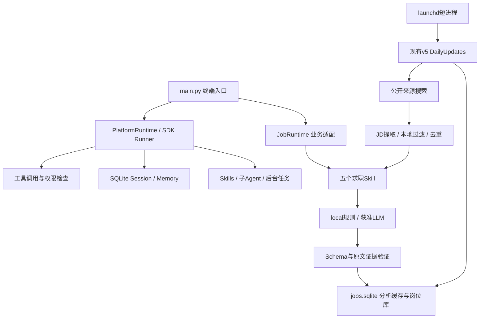

# 架构与工程边界

## 统一底座与业务适配

`JobRuntime` 继承统一运行底座，只替换业务工作区、instructions、工具集合和Skill目录；搜索、评分、岗位库与准备材料没有各自重造Agent框架。教学模块保留原文件名，避免搬动造成导入破坏。

## Agent Loop / Tool Calling

统一入口通过Agents SDK Runner执行“接收任务→选择工具→执行→回传结果→继续或结束”。Platform默认模拟模型只识别预设句式，工具、SDK循环、文件核对和测试实际执行。Job Agent本地决策模型安排Skill顺序，真实LLM在经确认的业务分析/准备工具内调用，不应将这个固定业务编排宣称为完全自主规划。

工具是Python函数适配；Terminal和文件修改受允许列表与专用工作区限制。修改先生成Diff，再确认，核对原文件未变化后才写。它不是运行任意不可信代码的安全沙箱。

## Memory / Session / Context

SQLiteSession保存对话，业务Memory保存岗位与报告。临时上下文、持久偏好、岗位记录职责不同。上下文按完整轮次管理，保留必要证据；原课程压缩实验不等于正式业务默认策略。个人简历在本地读取，报告中的证据和会话也可能含个人信息，所以整个状态目录都不公开。

## Skills / Multi-Agent / 任务

五个业务Skill为 analyze-jd、match-resume、skill-gap-analysis、resume-tailor、interview-prep。Skill按需加载，是业务约束与工具编排，不会代替系统权限。Platform另有受限子Agent演示，通过 `Agent.as_tool` 独立读/算并向主Agent返回结果；Job Agent求职流程没有假称每一步都由多Agent协商。

Background/Scheduled管理器支持进程内并发与计时。Job Agent v5持久化每日计划、检查记录与新增摘要；macOS部署适配仅把已授权的固定local检查接到launchd，不新增业务Skill。

## 公开搜索、证据与评分

只访问用户启用的可信公开HTTPS来源，检查robots、公开地址、响应大小/数量/超时，拒绝登录、验证码和自定义网页脚本。支持JSON-LD JobPosting、静态岗位卡片、公开详情链接等。城市来自JD实际地点，网站所在地不能证明岗位城市。

广州有效候选不足才上海、再深圳。城市偏好很强，但有充分职责、匹配与届别证据的高质量备选可越级，必须解释原因。来源可读取、JD可提取、符合实习资格、适合本人是不同结论，不能混为“可投”。校招不等于实习；未明确2027届、专业和在招状态时保留待确认。

匹配基于真实原文，区分完全、部分和未匹配；待确认不自动当掌握。Python基础不升级熟练度，SQLite项目不证明SQL熟练，职业目标不证明技能，项目名不证明项目未写明的能力。

单项分数为1/0.5/0；必须项权重2、加分项1，按有效要求汇总，任选组合只计一次。综合匹配度是规则覆盖指标，不是录用概率。推荐再考虑必须项、资格差距、城市、JD职责/成长证据、AI相关度、2027届。公司声誉没有独立核验就不擅自加分。

## SQLite与运行可靠性

搜索缓存使用公司/岗位/实际城市/类型及JD实质内容去重；分析缓存还区分简历指纹、规则版本、模式和模型。岗位库把稳定岗位编号与JD版本分开，更新JD不能重置状态、备注、首次发现时间。求职状态仅由用户CLI更改。定时更新先去重，只分析新增、实质变化或尚未完成评分的岗位。

每日检查有跨进程锁与持久化到期点，异常保存失败/中断而不无限重试。macOS部署参见 [每日运行](MACOS_DAILY.md)。长期使用仍需本机备份、监控失败及核对招聘信息；程序不能证明雇主实时仍有名额。

## LLM模式和安全

LLM使用已有客户端、模型配置、结构化输出、预算与证据验证；参数按任务复杂度选择。发给第三方的材料范围和费用必须事先确认，真实简历默认本地。Schema通过不代表语义全部正确，人工质量审查仍有价值。两个准备Skill的真实人工材料验收记录只留本机；公开合成回归能复现结构和边界，不能独立证明真实API质量。

本项目没有自动投递、邮件发送、网站登录、默认付费定时分析、任意Shell代理或新MCP安装。受信任来源、用户同意、文件允许列表和测试是分层防护，不应宣传为对所有恶意文件/网络攻击的完整隔离。
